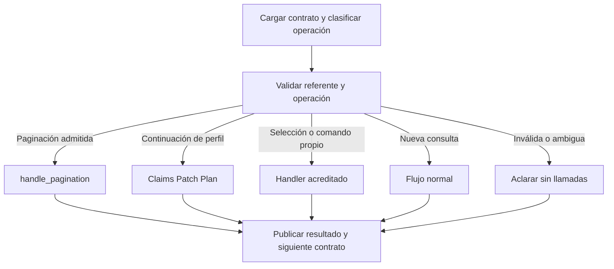

# ENTITY_PROFILE_FRAME_ARCHITECTURE_V1

Fecha: 2026-09-07. Estado: **DISEÑO V1 CONGELADO PARA IMPLEMENTACIÓN**.
Estado productivo: **NO_GO vigente; este documento no acredita remediación**.
Entrega: arquitectura y revisión del producto; cero cambios de runtime, tests,
datos, pins, ADR o bitácora. Una sola revisión en esta sesión de Codex; no se
ejecutó una sesión adicional con Opus ni una revisión independiente del diseño.

## 1. Decisión y procedencia

Entity Profile tendrá una autoridad del universo semántico confirmado:
`EntityProfileFrame`. `ExecutionPlan` será la autoridad del programa autorizado
de consultas. `Evidence` acreditará intentos, respuestas y hechos. El contrato
de continuación decidirá qué operación puede iniciar el siguiente turno.

Una precisión al encargo: un plan no prueba que una llamada haya ocurrido.
Los nombres `planned_jobs`, `attempted_calls` y `accredited_metrics` distinguirán
esas tres situaciones. No se llamará «ejecutadas» a las fuentes por el solo
hecho de aparecer en `jobs`, como hace hoy `executed_datasets`.

| Referencia | SHA / ubicación |
|---|---|
| Main observado | `7868664757b28bed16c583ea50327d669f1501e3` |
| Runtime V1.1 revisado | `62ec330a04f054cbd8ff6028bda3a67d08ce3a28` |
| Auditoría y base de este carril | `e024753a7a3e26a80aa0c07359078544f45f4ee5` |
| Rama documental | `codex/entity-profile-frame-architecture-v1` |
| Worktree | `/Users/rodrigoortiz/Documents/secoppal-entity-frame-architecture-v1` |
| Único archivo propio | `docs/architecture/ENTITY_PROFILE_FRAME_ARCHITECTURE_V1.md` |

Se leyeron `AGENTS.md` y [CARRILES.md](../orquestacion/CARRILES.md). La orden
del usuario autoriza este documento; no amplía permisos de implementación de
los carriles históricos. No se ocupa un número de ADR ni se edita un archivo
compartido. El delta entre candidato y auditoría contiene pruebas y evidencia,
sin cambios de `app/`. Este diseño parte del árbol de auditoría para conservar
los contraejemplos disponibles, incluidos sus rojos intencionales.

La [revisión independiente](../audits/entity_profile_v1_1_independent/INDEPENDENT_REVIEW.md)
prevalece como evidencia sobre el cierre declarado en
[ENTITY_ANALYSIS_V1](ENTITY_ANALYSIS_V1.md): ese documento todavía afirma que
los siete P1 están cerrados. No se reescribe la historia en este carril.

## 2. Funcionalidades y límites de producto que se conservan

| Funcionalidad | Contrato de esta arquitectura |
|---|---|
| Radiografía institucional | BuyerUnit productiva o BuyerGroup declarado; resumen breve, hasta ocho hechos en overview. |
| BuyerGroup | Referencia versionada y proyección acreditada de hasta 40 nombres físicos; no inferencia de miembros. |
| Territorio | «Analiza Baranoa» pide desambiguar; nunca transforma municipio, DIVIPOLA o metadata territorial en comprador. |
| Fuentes | Procesos `p6dx-8zbt`; contratos `jbjy-vk9h`; conteos y denominadores separados. |
| Proveedores | Dos TOP5 separados, por cantidad y valor; identidad documental existente y exclusión de placeholders antes de GROUP BY/LIMIT. |
| Valores | Suma y promedio contractuales; mediana sigue no disponible. Presupuesto de procesos no es valor contratado. |
| Modalidades | Distribución de procesos; filtrar contratos por una modalidad compatible no equivale a soportar una distribución de modalidades contractuales. |
| Temporal | Series acreditadas por fuente; periodos del Frame visibles por fuente. No sumar procesos y contratos como si fueran unidades iguales. |
| Recientes | Hasta tres registros por dataset con desempate estable; no son página 1 de una búsqueda tabular. |
| Fallo parcial | Conservar métricas acreditadas, identificar lo no disponible y evitar falsos ceros. |
| Consulta analítica puntual | Mantener autoridad y precedencia de suma/promedio puntuales. El perfil no captura cualquier pregunta con un comprador. |
| Nuevo comprador explícito | Nueva búsqueda con resolución propia; no hereda actor, tema ni filtros del universo anterior. |
| Actor Profile | Mantener selección por token/documento, TTL, kill-switch y autoridades existentes; este diseño no resuelve actores. |
| Búsqueda tabular | Mantener refinamiento, orden, grupos, paginación y recuperación de candidatos en su ruta. |
| Radar | Listar/ejecutar radares existentes conserva su ruta. Guardar «esta búsqueda» exige un referente exportable explícito. |
| Canales | Una decisión de dominio común para texto y selecciones estructuradas; adaptadores de canal no eligen otro universo. |

Presupuestos máximos del catálogo existente, después de proyectar fuentes:

| Foco | Fuentes con capacidad | Jobs máximos |
|---|---|---:|
| overview | procesos y contratos | 6; procesos solos 2, contratos solos 4 |
| suppliers | contratos | 2 |
| values | contratos | 1 |
| modalities | procesos | 1 |
| recent | procesos y contratos | 2; una fuente 1 |
| temporal | procesos y contratos | 2; una fuente 1 |

Se mantienen 8 s por llamada y 9 s globales como límites configurados actuales.
La arquitectura no promete que threads en vuelo terminen instantáneamente al
vencer el deadline. El runner debe registrar lo observado y no iniciar nuevos
jobs sin presupuesto. No se añaden llamadas por aclaración, parsing,
compilación, render o recarga. No hay probes live en este trabajo.

Fuera de V1.2: nueva capacidad de montos de procesos, distribución contractual
de modalidades, mediana, análisis territorial, joins de Actor/PAA, graph runtime,
warehouse, comparación estadística entre cohortes distintas y NLP general.

## 3. Diagnóstico que obliga al reemplazo

| Punto observado | Consecuencia para el diseño |
|---|---|
| `turn.py` compone request y llama `build_execution_plan(request, clean)` | Dos entradas pueden describir filtros distintos. El compilador nuevo sólo recibe Frame y catálogos explícitos. |
| `source_plan.py` copia params y `effective_scope.py` humaniza fechas del request | SQL y alcance visible deben compartir predicados compilados por fuente. |
| `semantic_request.event_for` asigna fuente según tipo del evento | Compatibilidad física no puede sustituir la relación textual fuente-evento. |
| `MaterialFilters._terms` aplana listas anidadas | OR debe conservar estructura; no se reconstruye a partir de términos planos. |
| `EntityProfileScope` también almacena tiempo, modalidad y tema | Es otra copia material que el reemplazo debe retirar de consumidores semánticos. |
| `execution_plan.py` lee provenance del turno y no origin | El origen explícito debe sobrevivir a todas las herencias. |
| `orchestrator._dispatch` atiende refinamiento y paginación antes del grafo normal | El control de continuación debe estar antes de esos caminos. |
| `ConversationStore.append_turn` hace append JSONL y genera el ID allí | No existe todavía el contrato de publicación versionada que requiere este diseño. |

Se identificaron además dependencias estructurales, sin elevarlas a nuevos
incidentes live ni atribuirles un test reproducido en esta revisión:

1. `SoQLBuilder._build_where` puede degradar AND a OR por rareza de términos.
   Su matching de frases de catálogo también puede representar coocurrencia
   amplia. Es útil para recuperar candidatos tabulares con ranking posterior;
   no debe redefinir silenciosamente un agregado institucional.
2. `radar._last_search_params` busca hacia atrás cualquier turno con alcance o
   tema. `suggestion.py` consume `modified_params`; `refinement.py` recibe params
   sembrados. Proteger sólo la palabra «más» deja otros caminos de continuación
   sin referente acreditado.
3. El buffer comprueba TTL y fingerprint, pero la mera existencia de historial
   no prueba que ese buffer corresponda al último resultado mostrado.

## 4. Autoridades y dirección de dependencias


Las flechas no permiten reentrada desde params a un Frame ya confirmado.
`Render` no parsea texto, no lee params legacy ni consulta fuentes. `Evidence`
no cambia la intención. `ContinuationContract` referencia contexto, no lo copia.
Los estados e IDs operativos no constituyen nuevas autoridades semánticas.

## 5. SemanticClaim: ocurrencias y relaciones acreditadas

Es un valor inmutable de evidencia de entrada. No decide identidades ni
ejecución. Su contrato mínimo es:

```text
SemanticClaim
  id: identificador único dentro del turno
  turn_id: turno al que pertenece el texto
  span: [start, end), índices de caracteres del texto original
  dimension: BUYER | SOURCE | EVENT | PERIOD | CURRENT_STATE | TOPIC
             | MODALITY | CONTRACT_TYPE | VALUE | FOCUS | OPERATION
  canonical_value: unión tipada por dimensión, sin dict arbitrario
  authority: identificador y versión de la autoridad productora
  relations: secuencia de {kind, target_claim_id}
      kind: HAS_SUBJECT | MODIFIES | PERIOD_OF | COORDINATES | EXCLUDES
```

Reglas obligatorias:

- Validar `0 <= start < end <= len(original_text)`, tipos exactos, IDs únicos,
  relaciones existentes y ausencia de ciclos de gobierno. Un booleano no es
  un offset válido. Un claim de otra versión/turno no se enlaza por accidente.
- Si una autoridad opera sobre texto normalizado, publica un mapa hacia el
  original. No reconstruir offsets con «primera coincidencia del término».
- Conservar todas las ocurrencias; no deduplicar por tipo de evento.
- La autoridad de buyer protege el span que ya acreditó; eso no habilita
  usar un alias, NIT o territorio como nueva autoridad de identidad.
- Una ocurrencia en un complemento temático no se reutiliza como petición de
  fuente. Puede haber relaciones entre spans y solapamientos explícitos; la
  regla no es prohibir todo solapamiento, sino toda apropiación contradictoria.
- Las autoridades existentes publican claims mediante adaptadores. Una salida
  legacy sin evidencia suficiente para enlazar se considera no resuelta; no se
  le inventa una relación porque haga ejecutable la consulta.
- El compositor admite una gramática acotada: núcleo de fuente, complementos
  coordinados, evento/estado y periodo enlazados. No añade un parser NLP global.
  Conectores ambiguos y adjunciones no únicas producen una cuestión pendiente.

Ejemplo estructural obligatorio, con los spans reales validados por el adapter:

```text
«analiza procesos publicados en julio y contratos firmados en agosto
  de alcaldia de baranoa»

SOURCE(processes) <- HAS_SUBJECT - EVENT(publication) <- PERIOD_OF - PERIOD(july)
SOURCE(contracts) <- HAS_SUBJECT - EVENT(signature)   <- PERIOD_OF - PERIOD(august)
```

La tabla de compatibilidad comprueba esos vínculos después de construirlos.
«Contratos publicados y procesos firmados» conserva los sujetos expresados y
se bloquea; nunca intercambia las relaciones para satisfacer la tabla física.

## 6. EntityProfileFrame: universo confirmado completo

Un Frame contiene la semántica necesaria para volver a compilar sin leer
`raw_query`, `parsed_params`, `resolved_params` ni un plan anterior.

```text
EntityProfileFrame
  schema_version: 1
  frame_id, revision
  buyer_scope: BuyerUnitScope | DeclaredBuyerGroupScope
      autoridad/version, identidad canónica y proyección acreditada por fuente
  focus: overview | suppliers | values | modalities | recent | temporal
  source_selection:
      requested: conjunto no vacío de PROCESSES / CONTRACTS
      origin: EXPLICIT | DEFAULT
  source_predicates: mapa exacto de requested -> SourcePredicates
  provenance: referencias a claims/turnos y versiones de autoridades

SourcePredicates
  temporal: {event, period: ClosedOrOpenInterval | UNBOUNDED,
             event_origin, period_origin}
  current_state: expresión tipada de estados de ESTA fuente, o TRUE
  topic: TopicExpression
  modality: {include: procedure_ids, exclude: procedure_ids}
  contract_type: {include: canonical_ids, exclude: canonical_ids}
  value: {lower, upper, magnitude, currency}, o UNBOUNDED
```

No hay campos temporales globales que compitan con los de cada fuente. Los
filtros comunes se distribuyen a sus destinatarios una vez al componer; cada
entrada inmutable define exclusivamente su fuente. `buyer_scope` no contiene
tema, modalidad ni periodo. La metadata territorial sigue siendo presentación.
El origen de fuente es persistente; cómo llegó al turno actual queda en
provenance y no controla la completitud.

`TopicExpression` es un árbol acotado `TRUE | TERM | PHRASE | ALL | ANY | NOT`.
ALL/ANY exigen hijos; NOT admite un operando compatible con el soporte de
exclusión. Vacío/ausente se distingue de conjunto contradictorio. Se conserva
el agrupamiento; ordenar hijos para un fingerprint no puede cambiar significado.
Cada átomo conserva la política de matching de su autoridad: campos de texto,
normalización y, en PHRASE, la modalidad de coincidencia. Una frase de catálogo
con coocurrencia no se anuncia como secuencia literal exacta. Una modalidad o
tipo negativo no se convierte en tema negativo para volverlo representable.

El modelo puede expresar árboles que un adapter todavía no soporte. El
compilador los rechaza antes de crear jobs; nunca aproxima un árbol mediante
aplanamiento, expansión exponencial o cambio de conectores. V1.2 debe soportar
como mínimo las formas reales actuales: AND de términos, OR anidado de términos,
frases de catálogo y exclusiones temáticas; un OR entre fuentes se aclara cuando
expresa una alternativa de elección, en vez de escoger una en silencio.

Los periodos guardan límites resueltos, operadores de inclusión y referencia
civil usada para resolver expresiones relativas. Recargar «agosto» no vuelve a
evaluarlo con la fecha de hoy. Se mantiene la política temporal acreditada de
la base: este diseño no introduce un cambio global a intervalos semiabiertos
ni declara cerrado el gate del último día, cuyo alcance sigue siendo parcial.
V1.2 admite un evento y un intervalo por fuente; varias ventanas de la misma
fuente requieren aclaración mientras no exista una proyección acreditada.

Los límites monetarios son valores exactos serializables, con operador y
magnitud, admitidos por la autoridad monetaria existente. No usar float como
serialización canónica ni truncar decimales para encajar en `int()` del builder.
Si una proyección no conserva precisión u operador, no se ejecuta. La misma
cantidad aplicada a ambas fuentes se rotula como presupuesto de procesos y
valor contractual, respectivamente. UNKNOWN monetario mantiene su aclaración.

No existe `other_filters: dict`. El adapter de admisión enumera cada filtro
material del parser: representado, rechazado o metadata no ejecutable con motivo.
Actor/contratista, comprador alternativo, geografía que ampliaría al buyer y
capacidades no acreditadas bloquean el perfil o conservan la ruta propia según
la intención. Ningún filtro material desaparece mediante una purga silenciosa.

## 7. EntityProfilePatch y estado pendiente

```text
EntityProfilePatch
  schema_version: 1
  patch_id, turn_id
  base_frame_ref: {frame_id, revision}, o NEW
  operations: secuencia de {target, operation, value?, evidence_refs}
  selection_of: {pending_id, alternative_id}, opcional

operation: KEEP | SET | CLEAR
target: focus | source_selection | source_predicates[source].dimension
```

Ausencia de operación significa KEEP. SET lleva valor tipado. CLEAR no lleva
valor y sólo se permite para filtros opcionales; no borra buyer ni deja fuentes
vacías. Operaciones contradictorias sobre el mismo target producen aclaración,
no «gana la última». Una negación añade/reemplaza el subárbol correspondiente
con SET, usando la composición de exclusiones acreditada; no requiere un merge
genérico de diccionarios.

| Entrada sobre un perfil | Operación congelada |
|---|---|
| «proveedores» | SET focus=suppliers; KEEP de las demás dimensiones. |
| «en 2025» con una fuente | SET periodo anual de esa fuente; conserva foco, evento y filtros. |
| «en 2025» con ambas y periodo común | SET periodo anual de ambas, con destinatarios explícitos en el patch. |
| «en 2025» con periodos diferentes | Aclarar si reemplaza ambos periodos o cuál modifica. |
| «sin filtro de fecha» | CLEAR periodo de las fuentes activas; conserva foco, estados y base de evento compatible. |
| «solo contratos» desde BOTH | SET fuentes=CONTRACTS/EXPLICIT; conserva los predicados de contratos. |
| «ahora procesos» desde contratos firmados | Proponer procesos con periodo heredado y su base propia; aclarar el cambio de evento antes de ejecutarlo. |
| «analiza la Alcaldía de Galapa» | NEW con resolución propia, sin heredar filtros anteriores. |

El cambio de fuente es una transformación tipada: nunca copia columnas físicas.
Si la fuente añadida no tenía predicados confirmados, no recibe por intuición
el evento de otra. En «procesos en agosto → proveedores → solo contratos», la
alternativa publicada debe explicitar que contratos usa fecha de firma y
conserva agosto; la selección completa esa propuesta.

El estado conversacional del perfil contiene exclusivamente:

```text
ProfileConversationState
  schema_version: 1
  confirmed_frame: EntityProfileFrame | null
  pending: null | {
      pending_id, base_frame_ref,
      patch: EntityProfilePatch,
      issues,
      alternatives: [{id, label, completion_operations}]
  }
```

Una alternativa es una lista de operaciones; no otra copia del Frame. El
candidato se reconstruye aplicando pending.patch a su base y después la
alternativa seleccionada. Validación y compilación se repiten antes de ejecutar.
`sí` no elige entre varias alternativas. Tokens/IDs viejos no se aceptan.

Mientras haya pendiente, un refinamiento no relacionado como «recientes» pide
resolver o cancelar lo pendiente, con cero llamadas. «Cancela ese cambio» borra
pending y conserva confirmed. Un nuevo pedido inequívoco puede abandonar la
pendiente y crear NEW; no se obliga al usuario a contestar una pregunta vieja
antes de iniciar cualquier otra consulta. Una aclaración nunca altera confirmed.

## 8. ExecutionPlan, SourcePlans y compilación

Interfaces conceptuales; este documento no implementa las funciones:

```text
collect_claims(text, authoritative_results) -> Claims | UnresolvedIssues
compose_patch(claims, conversation_state) -> Patch | PendingQuestion
apply_patch(frame, patch) -> CandidateFrame | InvalidPatch
compile_profile(candidate, capability_catalog, source_catalog) -> PlanDecision
execute_profile(ReadyPlan, client, deadline) -> Evidence
render_profile(ReadyPlan, Evidence) -> ProfileResult
publish_turn(expected_revision, result, profile_state, continuation) -> TurnRef
```

`PlanDecision` es una unión: READY con plan completo, NEEDS_CLARIFICATION con
issues/alternativas y **sin jobs**, o INVALID_CONTEXT sin llamadas. No admite
`clarification` junto a jobs ejecutables. Un error al construir cualquiera de
los SQL bloquea el envío del plan entero; un fallo de transporte posterior
permite la respuesta parcial acreditada.

El plan READY guarda `plan_id`, referencia exacta al Frame, versión de catálogo,
SourcePlans, jobs, secciones esperadas, limitaciones y presupuesto. Cada
SourcePlan contiene dataset, proyección de buyer, predicados físicos normalizados,
base temporal, magnitud monetaria y fingerprint de alcance. Cada job referencia
un SourcePlan y declara operación, agregación, orden/límite y SQL final.
SQL y alcance normalizado se congelan antes del primer I/O.

El compilador comprueba en este orden:

1. Esquema, resolución de buyer, spans/relaciones y completitud del candidato.
2. Fuente-evento-periodo-estado por ocurrencia; ninguna reasignación de sujeto.
3. Compatibilidad de todos los filtros y proyección física por fuente.
4. Capacidad del foco y política de completitud según `source_selection.origin`.
5. Catálogo de jobs y secciones, con cero ampliaciones posteriores del universo.
6. Construcción de todos los SQL y correspondencia de predicados, órdenes y límites.

Si las fuentes fueron EXPLICIT, todas deben poder atenderse para ese foco; una
incompatibilidad produce aclaración. Si fueron DEFAULT, puede usarse el subconjunto
compatible del foco, declarando la limitación; nunca añadir fuentes que no estén
en requested. Volver a overview no hereda un recorte de capacidad como si hubiera
sido una selección explícita del usuario.

### 8.1 El límite con SoQLBuilder

Se necesita una entrada de compilación de predicados ya acreditados. No puede
invocar indiscriminadamente el `_build_where(params)` conversacional, porque
contiene decisiones de recuperación, oportunidad y democión AND→OR.

La implementación deberá extraer/reutilizar emisores existentes para buyer,
texto, estado, modalidad, tipo, tiempo y valor mediante un adapter pequeño.
La entrada de perfil no ejecutará heurísticas de recuperación ni defaults
materiales que no estén declarados en su plan. No se crea un segundo catálogo
de modalidades, aliases o vocabulario de estados, ni un motor SQL genérico.
Los predicados adicionales necesarios para una métrica —por ejemplo, documentos
de proveedor elegibles— quedan identificados como restricciones de esa métrica,
sin presentarlos como cambios al universo general de contratos.

`params` puede existir como salida efímera para un emisor cuya equivalencia esté
acreditada; no se persiste para herencia ni se vuelve a leer para renderizar.
Un diccionario congelado o un hash coincidente no prueban equivalencia semántica.
Las pruebas compararán la estructura de predicados, el SQL realmente enviado y
la respuesta visible con un oráculo independiente del compilador.

La exclusión de modalidad sobre contratos debe conservar el NOT IN existente y
aparecer en alcance. `contract_type.exclude` está modelado, pero la base no
acredita esa proyección: se aclara hasta implementarla y verificarla. El control
«excepto obra» de la auditoría es exclusión temática, no prueba de tipo negativo.

## 9. Evidence y presentación

Se amplían los contratos existentes de `SourceCall`, métricas y reconciliación;
no se introduce otra clase genérica `Evidence` que compita con Truth Layer.
Cada registro de llamada referencia plan/job, dataset, alcance y SQL enviado;
distingue planificada, intentada, resultado de transporte y tiempo. Cada métrica
conserva su evidencia de validez, ausencia o contradicción por separado.

Estados conceptuales: VALID (incluido cero acreditado), MISSING, INVALID,
CONTRADICTORY y UNAVAILABLE por falta de respuesta; una sección no solicitada
continúa diferenciada de fallo. Se conserva conteo 4 aunque su monto sea NULL,
NaN, infinito u overflow. Un transporte SUCCESS no acredita un agregado ilegible.
Contradicciones sólo se comparan entre predicados equivalentes del mismo dataset
y ejecución; TOP5 de proveedores no aporta denominador de cobertura completo.

El renderer consume Plan + Evidence. Describe evento, periodo, estado, árbol
temático, inclusiones/exclusiones, buyer y magnitudes por fuente. Los filtros
idénticos pueden mostrarse una vez si la agrupación no borra diferencias.
En fechas diferentes se rotulan ambas cohortes y no se presenta una comparación
como si compartieran ventana. Error total sigue siendo respuesta del perfil,
con alcance intentado y limitación; jamás activa degradación/tabular como rescate.

La sección temporal deja de leer fechas globales de `EntityProfileScope`.
`expected_sections` y `not_requested_sections` tendrán consumidores reales:
assembler y renderer reciben las secciones del plan, no recalculan otra lista
según foco. Se conserva el catálogo actual de aspectos y la honestidad parcial.

## 10. ContinuationContract antes del dispatcher

Se elige una **admisión superior pequeña en Burr**, invocada desde `run_query`
antes de `_dispatch`, incluido `seed_resolved_params`. El grafo normal existente
se conserva como ruta delegada. La admisión reconoce operaciones mediante
autoridades existentes y devuelve una sola decisión; no parsea SQL ni duplica
la lógica de Actor, Radar o sugerencias.

```text
ContinuationContract
  schema_version: 1
  conversation_revision
  visible_turn_id, result_id
  result_kind: TABULAR_SEARCH | ENTITY_PROFILE | ACTOR_PROFILE | RADAR
               | CLARIFICATION | OTHER
  owner: autoridad de continuación que produjo este resultado
  target: unión discriminada por owner
    Tabular: {result_ref, grupos -> {cursor_id, fingerprint,
               order_contract, expiration, generation}}
    Profile: ConfirmedProfileRef {frame_ref, plan_ref, evidence_ref}
             | PendingProfileRef {base_frame_ref o null, pending_ref}
    Actor: {referencia al pendiente/resultado existente}
    Radar: {referencia al radar/resultado existente}
    Other: sin capacidad de paginar
```

`VisibleUniverse` es el nombre conceptual de este mismo contrato, no un segundo
objeto. No contiene otro Frame, params heredables ni copias de candidatos Actor.
Una aclaración referencia su dueño y pendiente; no se convierte por ausencia
de datos en resultado tabular. Si ofrecía escoger grupo tabular, puede continuar
ese resultado por selección explícita del grupo, manteniendo la referencia;
un «más» ambiguo no escoge el grupo por orden de handlers.



Ninguna transición de continuación inválida cae por default al parser tabular.
Los predicados de decisión serán mutuamente excluyentes y probados; Burr elige
la primera condición verdadera, no demuestra por sí solo que sean disjuntas.
El handler recibe la decisión admitida y el referente validado; ya no redescubre
su autoridad mediante `history[-1].parsed_params`. Un adapter de compatibilidad
es una proyección sin elección adicional de ruta.

### 10.1 Tabla de transiciones de producto

| Estado / resultado previo | Entrada | Acción permitida y condición |
|---|---|---|
| Sin historial o contrato inválido | «más» | Aclarar; cero consultas y ningún offset inventado. |
| Tabular de un grupo | «más» | Paginar sólo con cursor, generación, orden y fingerprint del resultado mostrado; agotado no consulta. |
| Tabular de dos grupos | «más» | Preguntar grupo; «más procesos/contratos» selecciona su capacidad válida. |
| Tabular con cursor vencido | «más» | Informar vencimiento y ofrecer repetir; no fabricar offset. |
| Tabular → Entity Profile | «más» | Aclarar qué profundización desea; no usar el cursor tabular anterior. |
| Entity Profile confirmado | «proveedores», «montos», «modalidades», «evolución», «recientes» | Patch de foco; compilar capacidad y origen de fuente. |
| Entity Profile confirmado | Cambio/limpieza temporal | Patch de los destinatarios definidos; no paginación ni listado. |
| Entity Profile pendiente | Selección válida | Completar pending.patch sobre su base; conservar foco/filtros propuestos. |
| Entity Profile pendiente | «sí» con varias alternativas | Repetir opciones; cero consultas. |
| Entity Profile pendiente | «recientes» u otro cambio no relacionado | Pedir resolver o cancelar; no ejecutar filtros pendientes. |
| Cualquier pendiente | Cancelación explícita | Cancelar en su dueño; mantener confirmado cuando exista. |
| Perfil o pendiente | Nueva consulta inequívoca | Ruta nueva; no herencia automática de filtros, actor o cursor. |
| Actor con candidatos vigentes | Número/token o documento | Delegar al handler Actor; validar su token, versión y TTL existentes. |
| Actor con selección vencida | Número/token viejo | Respuesta de selección inválida; no reinterpretar como sugerencia. Documento nuevo conserva autoridad de búsqueda independiente. |
| Tabular con sugerencias | Selección numerada/chip | Validar pertenencia al resultado y ejecutar su cambio acreditado. |
| Perfil confirmado | «1» sin opciones del perfil | Aclarar; no buscar sugerencias antiguas. |
| Perfil | Refinamiento desde UI | Exigir referencia al perfil y Patch tipado; un seed tabular no adquiere autoridad sobre ese Frame. |
| Tabular | Refinamiento desde UI | Conservar su ruta con referencia compatible; no convertirlo en perfil. |
| Cualquier resultado | Listar/ejecutar radar nombrado | Conservar semántica del comando y permisos existentes; no heredar filtros del perfil. |
| Perfil | Guardar «esta búsqueda» como radar | Explicar que el perfil no es una búsqueda exportable; ofrecer crear una búsqueda acotada y confirmarla antes de guardar. |
| Tabular exportable | Guardar «esta búsqueda» como radar | Exportar ese resultado; jamás elegir hacia atrás otro universo por tener params. |
| Cualquier resultado | Referencia explícita de proceso/contrato | Direct lookup conserva su autoridad; publicación sin cursor tabular implícito. |
| Cualquier resultado | Reset explícito | Invalidar continuidad/pending/capacidades correspondientes; conservar semántica de reset existente. |
| Perfil con fallo total de fuentes | «proveedores» | Recompilar mismo Frame con nuevo foco; declarar fallo anterior, sin simular éxito previo. |

La admisión siempre se ejecuta también para las entradas estructuradas de UI.
Los comandos explícitos de otra funcionalidad no quedan bloqueados por el mero
hecho de que antes se mostró un perfil. Sus handlers mantienen validación de
identidad, autorización y efectos externos. La adopción de este diseño no
autoriza crear radares o enviar mensajes durante la revisión.

## 11. Publicación, recarga y compatibilidad

Se conserva `ConversationStore` como almacenamiento conversacional. No se
introduce una base paralela de Burr ni se configura un tracker como segunda
fuente de estado. Un grafo nuevo por turno puede cargar el contrato persistido.

El sobre versionado del turno añade `profile_state` y `continuation` fuera de
los params materiales. Los datos canónicos se serializan en JSON estricto;
los lectores rechazan NaN/Infinity, versiones desconocidas, referencias rotas
y formas incompletas. La vista legacy para trazas puede ser generada, pero ningún
consumidor de perfil la usa para heredar.

Para un resultado ejecutado, el mismo registro contiene `execution_record`:
snapshot inmutable del Plan y resumen de Evidence por llamada/métrica. Las
referencias `plan_ref`/`evidence_ref` identifican esas secciones mediante
`turn_id` y sus IDs; no dependen de un caché en memoria ni de buscar un plan
parecido. Los datos crudos pueden seguir en las trazas existentes. El resumen
de Evidence no reinterpreta el Frame ni reemplaza la evidencia cruda. Una
aclaración inicial puede tener pending sin Frame confirmado ni execution_record;
su variante de contrato no exige referencias a una ejecución inexistente.

Secuencia de publicación:

1. Cargar la revisión vigente y reservar serialmente el turno del chat antes
   de ejecutar. La exclusión debe funcionar entre instancias del workflow;
   el RLock de un objeto de buffer no acredita esta garantía.
2. Construir candidato, plan y resultado en memoria. Una aclaración prepara
   pending; un READY prepara un nuevo confirmado, incluso si después las fuentes
   fallan, porque significado aceptado no es éxito de transporte.
3. Asignar el ID de resultado/turno antes de crear sus referencias. Publicar
   respuesta, Frame/pending y contrato juntos en un único registro versionado,
   verificando expected_revision. Los efectos analíticos son de lectura.
4. Sólo el registro completo publicado es autoridad para el siguiente turno.
   Un fallo de publicación no avanza el Frame durable ni entrega un cursor nuevo
   como confirmado. La respuesta informa que el contexto no pudo conservarse.

V1.2 debe implementar/adaptar la serialización de turnos por chat y el append
completo bajo su frontera de almacenamiento actual; no se presupone atomicidad
entre JSONL y sidecar. Un buffer puede prepararse antes, pero es inerte hasta que
un contrato publicado referencia su generación. Una lectura con cola corrupta
marca continuidad inválida; no salta silenciosamente a una línea vieja para
reactivar su cursor. Un crash puede obligar a repetir una consulta de lectura;
no se promete exactly-once de red ni un nuevo sistema transaccional global.
Para el almacén de archivos actual, la exclusión será por chat y entre procesos
que comparten ese almacén, con revisión esperada validada bajo el bloqueo; no
un candado global de todas las conversaciones. Una instalación con escritores
en almacenes no compartidos exige otra garantía acreditada antes de activarse.

El contrato describe la respuesta publicada por el servidor. Sin ACK del canal
no prueba que la persona la haya visto físicamente. No se añade un protocolo de
entrega a los canales; se exige consistencia del resultado que se devuelve.

Migración al leer, sin reescribir el histórico:

| Contexto | Resultado |
|---|---|
| Frame V1 nuevo íntegro | Validar esquema/referencias; recompilar con catálogo compatible. |
| Request V1/V1.1 y params legacy | Migrar sólo si se acredita completitud y equivalencia de todas las dimensiones. |
| Request dice agosto y params carecen de fecha o dicen julio | INVALID_CONTEXT y aclaración; ninguna preferencia silenciosa entre las dos copias. |
| `unsupported_event` legacy | Conservar el bloqueo en pending o invalidar; jamás descartarlo y ejecutar. |
| Span `[3]`, fuera de rango, tipo inválido | Invalidar sin crash ni contexto parcial inventado. |
| `estado` + `estado_field` legacy | Proyectar si autoridad/esquema son inequívocos; si no, aclarar sin purgar el filtro. |
| Tabular legacy sin tipo/cursor inequívocos | No paginar por historial; ofrecer repetir la búsqueda. |
| Actor pending legacy válido | Delegar la validación existente; no exigir un Frame de Entity Profile. |

La referencia a versiones de catálogo no habilita una búsqueda externa. Si la
proyección de buyer/filtros dejó de ser compatible, se pide nueva resolución
por su autoridad; no se adapta mediante fuzzy ni se cambia el universo callado.

## 12. Tabla de reemplazos y propiedad futura

| Pieza actual | Destino V1.2 y consumidor |
|---|---|
| `entity_profile/semantic_request.py` | Retirar autoridad runtime; sólo lector legacy de migración. Frame lo sustituye. |
| `conversation_state.py` | Reemplazar contenido por confirmed_frame + pending_patch; retirar requests duplicados y `state_context` como fuente heredable. |
| `turn.py` / `_composed_request` / `inherit_request` | Retirar merge request+params; coordinación mínima hacia claims/patch/compilador. |
| `source_request.py`, `temporal_event.py`, `clauses.py` | Convertir a productores/adaptadores de claims con vínculos; retirar scanners que consumen otra vez spans ya poseídos. |
| `EntityProfileScope` en `models.py` | Conservar identidad/scope de comprador; retirar campos tema/modalidad/fecha de sus consumidores semánticos. |
| `material_filters.py` | Retirar `from_params` y aplanamiento como interpretación; reutilizar etiquetas como presentación de predicados compilados. |
| `source_plan.py` | Compilar predicados por fuente; no copiar ni purgar un dict global. |
| `execution_plan.py` | Única compilación de capacidades, jobs y secciones; consume origen persistente y no parámetros paralelos. |
| `query_runner.py` | Conservar presupuesto, cliente y catálogo; ejecutar SQL del READY sin reconstruir filtros ni ampliar fuentes. |
| `aspects/*`, `evidence.py`, `sections.py` | Conservar cálculos server-side y parsers estrictos; enlazar evidencia por plan/alcance y cerrar finitud. |
| `assembler.py`, `effective_scope.py`, `render.py` | Consumir plan y evidencia; eliminar fallback semántico desde params/scope/request legacy. |
| `query_frame.py` global | Sigue autoridad/adaptador de su ruta tabular; no es el Frame de Entity Profile. |
| `workflow/result_ownership.py` | Conservar protección terminal intraturno; proyectar dueño al contrato de continuación. |
| `_dispatch`, handlers y `workflow/graph.py` | Enganche de admisión superior y acciones del perfil; no migración general de todo el dispatcher. |
| `conversation_store.py`, persistencia de handlers | Sobre publicado y lectura versionada; el sidecar de paginación sigue siendo caché. |
| Builder y autoridades de filtros | Emisores reutilizados bajo entrada de predicados; legacy tabular conserva sus decisiones. |

Archivos futuros sugeridos por responsabilidad: `entity_profile/frame.py`,
`patch.py`, `claim_composition.py`, `frame_migration.py` y
`workflow/continuation.py` más un módulo pequeño de admisión Burr. Son ubicación
del diseño, no autorización para crear todas esas clases automáticamente.
Reutilizar valores existentes cuando cumplan el contrato; cada incorporación
debe retirar la interpretación que reemplaza.

La implementación requiere asignación explícita para builder, dispatcher,
parsing/follow-up, persistencia y handlers compartidos. En particular, el perfil
debe tomar el camino de Patch antes del merge genérico en `apply_context`; no
basta corregirlo al final en `execute_query`. `query_plan.py` no es un punto
previsto de edición. Si apareciera esa necesidad, aplica NEXT_TOUCH_RULE y una
propuesta de extracción previa; no se sube el límite. La exposición de claims
por QueryRouter requiere un cambio acotado asignado a su dueño, no otro parser.

## 13. Matriz completa de los siete P1

Fecha de interpretación de ejemplos: **2026-09-07**, como en la auditoría.
Cada flecha implica publicar, cerrar instancia y recargar el mismo chat en otra
instancia. Para SQL se inspeccionan todas las llamadas, incluidos agregados.

| ID | Entrada/conversación completa | Resultado exigido por el diseño |
|---|---|---|
| R1a | «analiza contratos publicados y procesos firmados en agosto de alcaldia de baranoa» | Aclarar asociaciones incompatibles; cero jobs y llamadas. |
| R1b | «analiza procesos publicados en julio y contratos firmados en agosto de alcaldia de baranoa»; variante invirtiendo las dos cláusulas | Procesos por publicación en julio y contratos por firma en agosto; seis jobs de overview con fechas propias. La invariancia al orden es obligatoria en este caso inequívoco. |
| R2a | «analiza contratos terminados en agosto pero actualmente activos de alcaldia de baranoa»; variantes «que actualmente están activos», «aunque actualmente activos» y «hoy los contratos terminados en agosto» | Conservar hecho histórico no soportado; aclarar, sin sustituirlo por firma, por hoy o por estado terminado. |
| R2b | «analiza procesos actualmente abiertos y contratos actualmente terminados en agosto de alcaldia de baranoa» | Resolver explícitamente a qué predicado pertenece agosto o aclarar. Nunca perder estado de contratos. Control inequívoco: publicados en julio actualmente abiertos + firmados en agosto actualmente terminados debe conservar ambos estados y periodos. |
| R3a | «analiza contratos de software y gestion de procesos industriales de alcaldia de baranoa»; variante con coma | Sólo contratos; preservar complemento completo. No apropiarse de «procesos» como segunda fuente. |
| R3b | «analiza procesos de software y administracion de contratos de alcaldia de baranoa» | Sólo procesos; preservar «contratos» en tema. |
| R3c | «analiza procesos o contratos de alcaldia de baranoa» | Aclarar elección entre fuentes o ambas; no seleccionar procesos por precedencia. |
| R4a | «analiza contratos de mantenimiento o vias de alcaldia de baranoa» y control con «y» | SQL y alcance distinguen ANY de ALL; ambas consultas soportadas deben responder. |
| R4b | «analiza contratos excepto contratacion directa de alcaldia de baranoa» | Mantener NOT IN y declarar exclusión. «Excepto obra» sigue control temático; no acredita tipo contractual. |
| R5a | «analiza contratos firmados de alcaldia de baranoa en agosto» → «proveedores» | Dos jobs contractuales; todos conservan agosto/firma; foco suppliers tras recarga. |
| R5b | «analiza procesos y contratos de alcaldia de baranoa en agosto» → «proveedores» | Aclarar completitud por origen explícito; cero llamadas. Si se acepta «solo contratos», suppliers y agosto permanecen. |
| R5c | «analiza procesos de alcaldia de baranoa en agosto» → «proveedores» → «solo contratos» | T2 pendiente sin llamadas; alternativa informa firma; T3 dos jobs suppliers de contratos en agosto. |
| R5d | «analiza procesos de alcaldia de baranoa en julio» → «proveedores en agosto» → «recientes» | T2 y T3 aclaran sin llamadas; confirmed permanece julio. «Cancela ese cambio» → «recientes» ejecuta procesos de julio. |
| R6 | «analiza procesos y contratos de alcaldia de baranoa en agosto» → «proveedores»; repetir con «montos» | Aclarar sin jobs. Control DEFAULT: «analiza alcaldia de baranoa en agosto» → foco permite contratos con limitación declarada. |
| R7a | «analiza contratos de alcaldia de baranoa en agosto» → «mas» | Profundización por aclaración, cero offset y llamadas; jamás LIMIT 10 OFFSET 10. |
| R7b | «analiza contratos firmados de alcaldia de baranoa en agosto» → «sin filtro de fecha» | Responder como perfil sin límites temporales; mantener buyer/foco y conservar CLEAR tras otra recarga. |
| R7c adicional | Búsqueda tabular con página válida → «analiza contratos de alcaldia de baranoa en agosto» → «mas» | Cursor tabular anterior inerte, incluso si sigue físicamente en sidecar. |

Los JSON de cada incidente están enlazados desde el informe independiente.
Las salidas flexibles originales (ejecutar correctamente o aclarar) siguen
válidas como puerta de seguridad; las filas que aquí exigen ejecución añaden
una puerta de utilidad V1.2. No se debilita un test para simular esa utilidad.

## 14. Trazabilidad de los 35 adversariales

Los nombres siguientes pertenecen a
[reaudit.py](../../tests/test_entity_profile_v1_1_reaudit.py) y
[reaudit_evidence.py](../../tests/test_entity_profile_v1_1_reaudit_evidence.py).
Se preservan los archivos congelados; sus expectativas se portan al contrato
nuevo mediante un adapter de observación de tests, sin mantener por ello una
API legacy productiva. Cada port debe demostrar equivalencia de la aserción.
Una clave interna antigua como `_entity_profile_request` puede aparecer en el
adapter de observación de tests para comparar el significado, pero no debe
forzar la permanencia de ese lector/escritor en producción.

| Función `test_…` (prefijo omitido) | Casos | Contrato |
|---|---:|---|
| coordination_does_not_invent_or_discard_sources | 4 | Claims y tema/fuente; R3 |
| source_and_occurrence_own_their_temporal_predicate | 5 | Gobierno y estados por fuente; R1/R2 |
| each_event_owns_its_period_or_clarifies | 2 | Periodos propios e invariancia al orden; R1 |
| real_parser_or_is_not_rendered_as_and | 1 | ALL/ANY real del parser; R4 |
| negative_and_legacy_filters_are_honored_and_declared | 3 | Modalidad negativa, control temático y estado legacy |
| explicit_origin_still_requires_complete_answer_after_reload | 2 | Origin persistente; R6 |
| explicit_pending_choice_preserves_the_requested_focus | 1 | Completar pending.patch; R5 |
| displayed_inherited_period_is_in_every_executed_query | 2 | SQL real vs alcance y recarga; R5 |
| pending_period_does_not_leak_into_confirmed_execution | 1 | Aislamiento pendiente; R5 |
| explicit_source_switch_does_not_inherit_incompatible_event | 1 | Cambio tipado de fuente |
| remove_period_is_not_silently_restored | 1 | CLEAR durable; R7 |
| property_current_marker_does_not_erase_relative_historical_event | 1 | Invariante de gobierno; R2 |
| contract_count_preserves_decimal_truth | 3 | Precisión/entero y conteo independiente |
| tiny_positive_invalid_count_does_not_render_zero | 1 | Underflow no acredita cero |
| temporal_value_rejects_nonfinite_source_metric | 3 | NaN/±Infinity no invalidan conteo válido; P2-C |
| v1_unsupported_event_is_not_lost_on_compatibility_reload | 1 | Migración conserva bloqueo; P2-B |
| malformed_claim_span_is_discarded_without_crashing | 1 | Serialización estricta; P2-B |
| profile_does_not_seed_a_tabular_pagination_result | 1 | Contrato de continuación; R7 |
| property_underflow_never_accredits_zero_count | 1 | Propiedad de evidencia |
| **Total** | **35** | **24 + 11; histórico 27 rojos y 8 controles verdes** |

## 15. Gates para implementar y promover

### 15.1 Gate de diseño, antes del primer cambio productivo

- Una sola autoridad del significado confirmado; no campo material heredado
  fuera del Frame. Plan y Evidence tienen responsabilidades distintas.
- Contratos y destinos de retiro definidos para las cinco primitivas del encargo.
- Tabla de transiciones incluye entradas de texto/UI y todos los caminos que
  pueden evitar el grafo normal, también refinamiento sembrado y Radar SAVE.
- Los siete P1 tienen secuencias completas y los 35 tests tienen destino.
- No quedan decisiones «TODO» sobre herencia, CLEAR, origin o selección pendiente.
- Identidad, fuentes y capacidades existentes permanecen acreditadas por sus
  autoridades. Una ampliación futura requiere un contrato separado.

Resultado de auto-revisión documental: esos requisitos están cubiertos por las
secciones 2–14. Es una comprobación del diseño por su autor; no un GO de runtime
ni una falsificación independiente del diseño.

### 15.2 Gate de seguridad y utilidad V1.2

1. Pasan los 35 adversariales portados sin debilitar invariantes, y los controles
   positivos originales. Ningún skip/xfail nuevo para ocultar un fallo.
2. Pasan las 856 focales existentes acreditadas en la auditoría (730 + 126),
   el corpus 89/89 y los grupos adyacentes afectados que aparezcan al implementar.
   Las cifras son alcance histórico, no conteo fijo para una suite futura.
3. Corpus de utilidad con éxito obligatorio para buyer reconocido, cada foco,
   BOTH DEFAULT, periodos diferentes inequívocos, AND/OR, exclusiones admitidas,
   cambio temporal, selección pendiente y CLEAR. Cero regresiones de esos casos
   a «aclarar siempre» y cero llamadas extra respecto al catálogo.
4. Todas las aserciones de universo observan entrada, Frame, jobs, SQL enviado,
   Evidence, render y recarga; no sólo objetos serializados o texto de etiquetas.
5. Pruebas de sustitución evitan una autoridad oculta: corromper params/trazas
   legacy no cambia el nuevo Frame ni SQL. Un plan no consume un Frame con otra
   revisión. Una fuente fallida nunca crea cero o fuente alternativa.
6. Hypothesis determinista y sin red: round-trip del Frame; KEEP conserva campos;
   CLEAR es idempotente; parches sobre dimensiones independientes conmutan;
   no se exige conmutatividad a cambio de fuente + periodo; pending no modifica
   confirmado; permutar cláusulas vinculadas conserva predicados; cursores de
   resultados distintos se rechazan; métricas no finitas nunca acreditan montos.
7. Mutaciones contra controles verdes: intercambiar sujeto/evento, globalizar mes,
   aplanar OR, omitir exclusión, usar provenance, aplicar pending sin selección,
   reactivar cursor viejo, evadir admisión con seed, reinterpretar params en
   render/builder y convertir transporte SUCCESS en validez. Cada kill debe ser
   aserción conductual; import errors y timeouts no cuentan.
8. Pruebas de publicación/reload: dos instancias del mismo chat, intercalación de
   revisiones, escritura truncada, sidecar huérfano, cursor antiguo, versión
   desconocida y cambio de catálogo. No se afirma atomicidad por leer el código.
9. Paridad de rutas externas: Actor (token, TTL, documento y kill-switch), Radar
   LIST/RUN/SAVE, lookup, sugerencias, refinamiento, reset y búsquedas tabulares.
   La selección de una operación no depende del orden accidental de handlers.
10. Ruff literal verde; Semgrep baseline separado y cero nuevos propios;
    diff-check del intervalo de commits. El orquestador corre la suite global
    una vez y en serie sobre el SHA final; no se repinean guardas para lograr GO.

### 15.3 Orden de implementación y cortes revisables

| Paso | Entrega | Condición para continuar |
|---|---|---|
| 0 | Asignar propiedad de archivos compartidos y fijar base/invariantes | Sin escritores concurrentes sobre el mismo archivo; diseño congelado. |
| 1 | Claims/Frame/Patch y migración puros, adapter de observación de tests | Esquemas y propiedades; ninguna ruta productiva usa dos autoridades. |
| 2 | Compilador, emisores, Evidence y render del perfil | Unidad completa Frame→SQL→alcance; eliminar lectores semánticos antiguos en esa ruta. |
| 3 | Integración del perfil con persistencia, admisión superior Burr y handlers | R5/R7, recarga, publicación y paridad externa; activar conjuntamente los lectores/escritores nuevos. |
| 4 | Contraejemplos, utilidad, mutaciones y revisión independiente de SHA | Seguridad y utilidad pasan; luego gate global del orquestador. |

Los pasos 1–2 pueden existir sin activación productiva; no se publica un híbrido
que escriba Frame y siga heredando params. El corte de activación conecta todo
el trayecto y retira los lectores sustituidos. Rollback conserva contextos nuevos
como incompatibles si el lector viejo no los entiende; no los reinterpreta.
Ese rollback requiere un lector compatible con el rechazo de la versión nueva:
volver al binario V1.1 sin ese guard no está acreditado como rollback seguro.
La prueba de rollback forma parte del gate de migración antes de activar.
No se recomienda integrar la rama de auditoría con sus rojos como entrega de
runtime ni mezclar esta remediación con los carriles en cuarentena.

## 16. Revisión y validación de esta entrega documental

Se inspeccionaron código del candidato, contratos del producto, los dos archivos
adversariales, logs congelados y las rutas de dispatcher/persistencia. Se verificó
que los 103 artefactos del manifiesto independiente mantienen sus hashes.
No se repitieron consultas SECOP, pruebas live ni campañas de mutación.

Preflight realizado: Ruff **0.16.4**, Semgrep **1.176.0**, Hypothesis **6.165.10**,
Codegraph **0.9.6**, Burr **0.40.2**. Se leyó la implementación instalada de
`Graph.get_next_node` y validación de writes de Burr. La
[documentación oficial de transiciones](https://burr.apache.org/docs/concepts/transitions/)
respalda el control de flujo por condiciones; no se presupone una garantía de
atomicidad conversacional ni autoridad semántica provista por el framework.

Codegraph MCP estuvo cargado y se usaron context/impact sobre el índice de la
auditoría, cuyo runtime es el mismo de esta base. `codegraph status`:
**867 files / 20,428 nodes / 49,751 edges; Index is up to date**. No se afirma un
índice propio nuevo. `impact(handle_pagination)` devolvió sólo dos símbolos pese
al caller directo en `_dispatch`: se declara fallback explícito a `rg` y lectura
manual para rutas/consumidores. Ese resultado no prueba impacto cero.

Puertas ejecutadas desde este worktree con el entorno canónico:

```text
/Users/rodrigoortiz/Documents/secoppal/.venv/bin/ruff check app/ tests/ scripts/
All checks passed!

/Users/rodrigoortiz/Documents/secoppal/.venv/bin/semgrep --config .semgrep/secoppal-laws.yml app/ --metrics=off
Ran 3 rules on 282 files: 10 findings.
```

Semgrep: baseline rojo 10, actual 10, nuevos 0. No hay delta en los archivos
escaneados ni en las reglas respecto de la base de auditoría. El exit 0 de la
herramienta no convierte esos diez hallazgos en verde.

Pytest: **NO EJECUTADO** en esta pasada. Hypothesis disponible, **no ejecutado**:
se especificaron propiedades futuras y no se añadió una prueba ornamental a un
cambio Markdown. **Corrí Ruff y Semgrep, no la suite.** Los `27 failed, 8 passed
in 4.91s`, 730/126 y corpus del informe son resultados históricos verificados en
sus artefactos, no una nueva ejecución. El NO_GO productivo permanece vigente.

La comprobación final de este documento verifica enlaces locales, suma de casos,
manifiesto de evidencia, alcance exclusivo del delta y `git diff --check`.
El commit de entrega se publica en la respuesta del carril para evitar una
referencia autorreferencial en su propio contenido.

Fuera del carril, sin tocar: diez hallazgos Semgrep; cierre V1.1 desactualizado;
deuda de serialización/publicación compartida; heurísticas de recuperación del
builder y exportación de Radar; anomalía de formato de sugerencias ya documentada
en su handler. Sus efectos completos requieren pruebas focales futuras; no se
presentan como nuevos defectos live demostrados aquí.

Pendiente por alcance: implementación V1.2, validación de sus invariantes,
revisión independiente y cualquier decisión de integración. Este diseño deja
esas tareas definidas y no sustituye sus puertas de aceptación.
